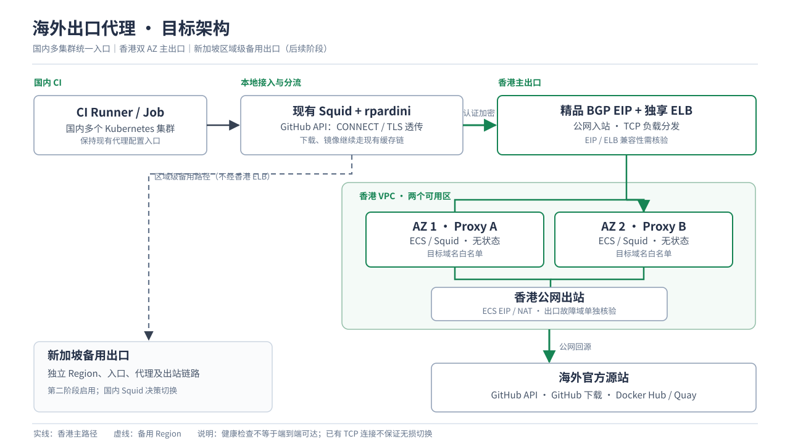

# RFC：华为云高可用、低时延海外出口代理

- 状态：Proposed（待架构评审）
- 日期：2026-11-15
- 范围：Ascend CI 国内集群访问 GitHub API、GitHub 下载源、Docker Hub、Quay 等海外服务
- 交付：出口代理架构与验收契约；本 RFC 不修改现网部署

## 1. 背景与问题

国内 CI 节点直连 api.github.com 存在连接超时、Connection reset、TLS 握手失败；GitHub Clone、Release 和 Registry 回源也受跨境链路质量影响。现有平台已部署 Squid + rpardini 缓存，具备 CI 显式代理入口与缓存能力，不能因为增加海外代理而重复建设缓存。

已核对 [ascend-ci-deployment 的注入脚本](https://github.com/opensourceways/ascend-ci-deployment/blob/main/scripts/squid-injection.py)：默认 NO_PROXY 包含 api.github.com，因此部分 Runner 请求会绕过本地 Squid。现有 [Squid Chart](https://github.com/opensourceways/ascend-ci-deployment/blob/main/manifests/squid-rpardini/chart/templates/configmap.yaml) 对非 Registry HTTPS 默认 SSL Bump。GitHub API 是带身份凭据的动态请求，不应解密或缓存。

核心矛盾：**国内到海外的网络质量不稳定；单个代理 ECS 只能转移故障位置，不能提供端到端高可用。**

## 2. 目标与非目标

| 优先级 | 目标 | 可验证的判据 |
| --- | --- | --- |
| P0 | 提升连接可靠性 | 按集群、运营商、目标域统计 TCP 连接超时、RST、TLS 失败和完整请求成功率；与国内直连对照 |
| P0 | 消除单 ECS、单 AZ 故障 | 任一代理节点或 AZ 故障后，新连接自动转至健康实例；故障注入验证 |
| P0 | 保护凭据与访问边界 | GitHub API 使用端到端 TLS；代理间链路加密、身份认证、目标白名单；无开放代理 |
| P1 | 降低尾延时 | 关注 TCP+TLS 建连 P50/P95/P99、成功请求 TTFB 与下载吞吐；按运营商和时段对比 |
| P1 | 降低维护成本 | 国内 CI 仍使用现有 Squid 地址；路由、健康状态与配置集中管理，支持灰度和回滚 |
| P2 | 提升 Region 级韧性 | 香港区域级故障时，后续可以切换至独立 Region 的备用出口 |

**建议验收门槛（待 7 天基线确认）：**
- 代理自身可归因可用性目标 ≥99.95%/30 天；GitHub 源站 4xx/5xx、上游自身故障单独统计。
- 测试窗口内，GitHub API 网络类失败率相对直连降低 ≥50%；不能以仅增加重试次数替代改善。
- 单代理或单 AZ 故障后，新连接恢复 P95 ≤30 秒；不承诺已建立 TCP 流无损迁移。
- P95 TCP+TLS 建连时间不高于相同采样窗口内直连 P95；若未达标，不能直接认定低延时目标完成。
- 所有判据须提供样本量、观测窗口、客户端集群/运营商、目标域与失败分类。

**非目标：** 替代现有国内软件包/Registry 缓存；缓存 GitHub API 响应；通过更换出口绕过 GitHub 认证或限流；默认代理全部 CI 控制面流量；在本 RFC 中确定最终 ECS 规格或带宽价格。

## 3. 推荐架构

采用 **国内 Squid 域名分流 + 香港多 AZ 无状态代理 + 可观测的跨 Region 备用出口**。

**图 3-1 · 海外出口代理目标架构。** 主路径为国内 Squid → 香港精品 BGP EIP / ELB → 双 AZ 代理 → 海外官方源站。国内缓存链保持不变；新加坡为第二阶段的独立区域级备用出口。

注：精品 BGP EIP 与独享型 ELB 的产品组合、香港公网出站故障域尚待华为云账号级验证；图示为目标方案，不代表已部署。

### 3.1 核心组件职责

| 组件 | 职责 | 与相邻组件的接口 |
| --- | --- | --- |
| 国内 Squid | 域名分类、GitHub API 透传、选择健康上游；维持现有缓存路径 | Runner 显式 HTTP(S) proxy；向香港代理发 CONNECT |
| 香港精品动态 BGP EIP | 优化国内至香港的公网接入与返回路径 | 绑定接入层公网入口；**不保证香港至 GitHub 的出站路径质量** |
| 独享型 ELB | TCP 负载分发、后端健康检查、跨 AZ 摘除 | 接收已认证/加密代理链路；转发到代理实例 |
| 香港 Squid A/B | 只允许授权来源和白名单域名的 CONNECT；不做 SSL Bump、不缓存 API | CONNECT 至官方源站，保留端到端 TLS |
| 公网出站路径 | 香港到 GitHub / Registry 的实际互联网回源 | ECS EIP 或 NAT SNAT；必须验证出口带宽、IP 与故障域 |
| 健康与路由控制 | 从国内客户端视角检测链路质量、记录出口状态、执行受控切换 | 采集分段指标；改变国内 Squid 上游选择 |

**重要边界：** ELB 的 TCP 健康检查只能检测代理端口，不能证明其到 GitHub 可达。必须另建从国内 CI 视角发起的端到端探测，避免把出站链路故障误判为代理健康。

### 3.2 三段链路分别优化

1. **国内 CI → 香港入口：** 香港精品动态 BGP 作为首选；按电信、联通、移动及不同集群实测。精品 BGP 是 EIP 线路属性，不是 VPC 属性。
2. **香港入口 → 代理：** ELB + 2 AZ 独立 ECS，配置无状态；首版不必引入 CCE。ELB 只承担会话建立时的负载分发，不保证已有长连接迁移。
3. **香港代理 → 海外源站：** 比较 ECS 独立 EIP 与 NAT SNAT；避免所有实例共享未经验证的单个 NAT/出站 IP 故障域。出站 IP、DNS 解析、IPv4/IPv6 和源站限流独立测量。

### 3.3 协议与安全

- 国内 Squid 对 api.github.com 采用 CONNECT 透传（splice），不终结 GitHub TLS，不缓存认证 API 内容；保留现有非 API 缓存策略。
- 国内到香港的 **代理间连接须加密并认证**（例如 mTLS 保护的上游代理，或经合规审批的加密私网连接）；不能仅凭公网源 IP 信任。
- 香港代理仅允许明确的客户端身份、CONNECT 方法、端口 443 与审批过的域名白名单；禁止通用公网代理、开放转发和任意内网/元数据地址访问。
- GitHub Token 只在客户端与 GitHub 之间的 TLS 中传输；日志仅保留必要的域名、状态、时延与字节数，不记录 Authorization、Cookie 或完整带凭据 URL。
- 对 GitHub API 的 401/403/429 使用认证与限流机制处理；自动出口切换仅针对经判定的网络/代理故障。非幂等请求不作无条件重放。

### 3.4 故障切换

| 故障范围 | 检测与响应 | 边界 |
| --- | --- | --- |
| 单 ECS/代理进程 | ELB 摘除不健康后端；实例由部署系统恢复 | 已建立 TCP 连接可能断开 |
| 单 AZ | ELB 转发至另一 AZ；健康副本保留容量 | 验证 AZ 故障时是否仍有出站路径 |
| 单 EIP、精品 BGP 入口异常 | 国内端到端探针发现链路退化，切换到独立入口 | 单个 ELB/EIP 不应被写成区域级容灾 |
| 香港到 GitHub 的公网故障 | 监测 CONNECT 之后的 TLS/HTTP 探测；切换出站路径或地区 | ELB 后端 TCP 仍可能显示健康 |
| 香港 Region 故障 | 第二阶段启用独立 Region（建议新加坡） | 异地延时可能增加；恢复策略要优先可用性 |
| GitHub HTTP 403/429 | 保持身份与限流处置，不视为出口故障 | 不用代理轮换规避限流 |

跨 Region 切换由**国内路由层**发起；只改变后续新请求的上游选择。需要熔断、滞回与恢复探测，避免两个出口反复抖动。

## 4. 选型与关键取舍

| 方案 | 优点 | 主要不足 | 决策 |
| --- | --- | --- | --- |
| 1 ECS + 精品 BGP EIP | 最简单、成本低 | ECS/AZ 单点 | 仅用于早期网络基线 |
| **双 AZ ECS + 独享型 ELB + 精品 BGP** | 托管接入、健康分发、无状态扩展 | 仍有香港 Region、入口 EIP、出口 NAT 故障域 | **首选目标方案** |
| 香港 CCE + ELB | Pod 自愈与扩缩容便利 | 新增 CCE 控制面、CNI、节点维护 | 已有可复用 CCE 或规模扩大时再评估 |
| GA 全球加速 + 香港/新加坡出口 | 全球接入、跨区域调度能力 | 费用、跨境资质、端到端效果需验证 | 对照测试后决定 |
| 仅 DNS 多 IP / 单 Squid cache_peer | 成本低 | 不保证及时发现端到端故障 | 不单独承担 HA 目标 |

**云产品前置核验：** 中国香港当前账号是否可将精品动态 BGP EIP 绑定所选独享型 ELB、双 AZ 和配额是否可用；如不支持，则采用两个独立精品 BGP EIP + 代理实例/独立入口，国内侧完成多上游健康选择。此兼容性在验证前**不得标记为已确认**。

**GA 使用约束：** 涉及中国大陆接入与境外终端的 GA 跨境通信需要相应资质审核；只有性能或区域故障收益覆盖成本、复杂度后才引入。

## 5. 与现网 Squid 的集成

当前事实：
- [生产 Squid 设计](https://github.com/opensourceways/ascend-ci-deployment/blob/main/manifests/squid-rpardini/SQUID-DESIGN.md) 已区分下载缓存、git-cdn 与 Registry Blob 缓存。
- [Squid 模板](https://github.com/opensourceways/ascend-ci-deployment/blob/main/manifests/squid-rpardini/chart/templates/configmap.yaml) 默认对非 Registry HTTPS bump，必须为 GitHub API 增加优先的 splice 分流，并验证 CONNECT 到上游 peer 的实际路由。
- [Runner 注入脚本](https://github.com/opensourceways/ascend-ci-deployment/blob/main/scripts/squid-injection.py) 的 NO_PROXY 含 api.github.com，迁移时须同步修改注入常量、校验逻辑、实际 Job 模板和文档。**GitHub Actions Listener/Runner 控制面流量单独灰度，不和普通 Job API 调用一起切换。**

边界：本 RFC 只规定接口与策略，不直接修改 ascend-ci-deployment 的 Helm Chart；具体 Squid peer 规则需在目标镜像版本完成配置解析与端到端验证。

## 6. 验收与实验设计

**测试仓库复用：** 此仓库的 Compose/K8s HA 套件用于单实例和节点故障；新增测试应覆盖跨区域真实出口、TLS 透传、代理权限及 GitHub API。现有缓存 HIT 测试不能代替出口 E2E 可用性测试。

| 场景 | 输入/扰动 | 必须输出的证据 |
| --- | --- | --- |
| A. 基线 | 同集群同时比较直连、国内 Squid、香港代理；含昼夜时段 | TCP、CONNECT、TLS、HTTP、TTFB P50/P95/P99；网络失败率 |
| B. 多网络 | 不同 region/三网出口及至少两个 API/Registry 源站 | 按客户端区域、ISP、目标域分层的成功率与延时 |
| C. 单点故障 | Kill ECS、进程、停止 ELB 后端、断开单 AZ 出口 | 故障检测、停止新流量、恢复耗时；旧连接中断数量 |
| D. 路由失效 | 阻断香港→GitHub，保持 Squid TCP 端口健康 | E2E 探针识别与路由切换，不能被 ELB 健康状态掩盖 |
| E. 整区故障 | 香港入口不可达 | 备用 Region/受控直连恢复新请求，并记录失败窗口 |
| F. 安全 | 非授权源、非白名单域、内网地址、非 443 CONNECT | 拒绝并记录审计事件；GitHub 官方证书链保持有效 |
| G. 性能容量 | 并发连接数、持续大文件、混合小 API 请求 | 带宽上限、连接数、CPU/RAM、每 GB 成本、P95 延时 |
| H. GitHub 语义 | 401/403/429、GitHub API 非幂等请求 | 无凭据泄漏、无限重试、错误出口切换 |

- 基线至少覆盖 **7 天**，所有对照在同一客户端、同一时间窗口执行；记录 ISP、IPv4/IPv6、DNS 结果与请求成功/失败状态。
- 对 GitHub API 合理限频，避免压测本身触发 GitHub 限流；高并发与大流量使用受控测试目标或测试对象。
- 可用性按「代理自身故障」「网络故障」「上游 HTTP 失败」「客户端认证/配置」分类；不能把 GitHub 429 计为精品 BGP 故障。
- 故障注入必须保存前后端日志、抓包/连接状态、探针样本和操作时间戳；只验证新连接恢复，不宣称已有连接零中断。

## 7. 实施阶段与回滚

1. **P0：产品与基线验证。** 核实华为云精品 BGP/ELB/NAT 的实际组合、配额、跨境合规与价格；完成 7 天对照。
2. **P1：最小可用出口。** 香港单节点、认证加密、GitHub API CONNECT；一个非关键 Runner 工作负载灰度；失败可回退旧直连。
3. **P2：香港高可用。** 双 AZ、托管 ELB、独立出站故障域、E2E 探针、单 AZ 故障演练；达到 P0/P1 验收门槛。
4. **P3：区域级韧性。** 新加坡独立出口、国内路由层熔断和恢复、区域故障演练。
5. **P4：按数据优化。** 若精品 BGP 达不到目标，再对 GA、其他线路/出口及 CCE 做性能、成本对照。

回滚：按集群、项目与目标域控制；关闭 GitHub API 香港路由时恢复原 NO_PROXY/直连策略；缓存/Registry 路径不随新出口回滚。控制面变更必须独立回滚。

## 8. 请求评审的关键决策

1. 是否接受 **国内 Squid → 香港双 AZ 出口 → GitHub** 作为主方案，而非为每个 CI 工具单独设置代理？
2. GitHub API 的 Runner 控制面请求是否纳入首期？建议首期仅普通 Job，控制面单独验证。
3. 是否接受「香港双 AZ 首期、独立 Region 第二期」的容灾边界及拟议验收门槛？
4. 香港接入层是否可以购买并绑定精品 BGP EIP？香港出站 NAT 的独立故障域如何保证？需要云平台实测/配额确认。
5. 是否已有可用的经批准跨境私网连接；如无，采用何种 mTLS 代理间传输与凭据轮换方案？

## 9. 参考资料

- 本仓库 [HA 方案](../solution.md)、[测试策略](../test.md)、[生产约束](../PRODUCTION.md)。
- [华为云：精品动态 BGP 与全动态 BGP 对比](https://support.huaweicloud.com/eip_faq/faq_bandwidth_0013.html)。
- [华为云：独享型 ELB 健康检查](https://support.huaweicloud.com/usermanual-elb/elb_ug_hc_0001.html)。
- [华为云：GA 支持的终端节点类型](https://support.huaweicloud.com/usermanual-ga/ga_03_4001.html)。
- [华为云：全球加速跨境资质](https://support.huaweicloud.com/usermanual-ga/ga_03_8001.html)。
- [Squid 官方 cache_peer 文档](https://www.squid-cache.org/Doc/config/cache_peer/) 与 [SSL Bump](https://wiki.squid-cache.org/Features/SslBump)。
